# Blinkit 유저 플로우와 실행 화면

Blinkit은 지출과 소비 이유를 기록하고, 필수·의식적·감정적 소비로 분류해 돌아보는 가계부입니다.
이 문서는 화면 이동과 시연 순서를 파악할 수 있도록 현재 프론트엔드 코드와 저장소의 실행 화면을 함께 정리합니다.

> 코드 확인 기준: 2026-10-21. 이미지는 README에서 연결하는 `screenshots/origins/` 원본을 직접 사용합니다.
> 기존 이미지의 촬영 시점과 뷰포트는 확인되지 않았으므로 현재 배포 화면과 다를 수 있습니다. 아래 기능 설명은 연결된 소스 코드를 기준으로 합니다.

## 유저 플로우

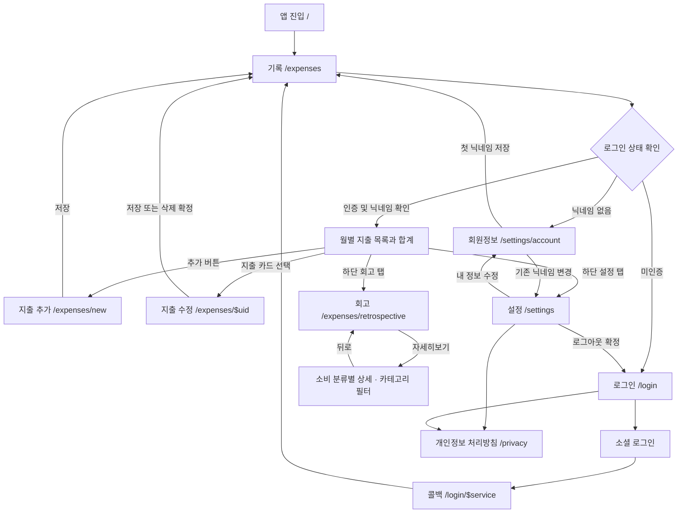

기록·회고·설정은 하단 탭으로 이동합니다. 인증이 필요한 화면에는 `AuthGuard`가 적용되며, 미인증 사용자는 로그인으로, 닉네임이 없는 사용자는 회원정보로 이동합니다.
로그인 화면에는 구글·네이버 버튼이 표시됩니다. 각 제공자의 실제 로그인 가능 여부는 서버 설정에 따라 달라집니다.

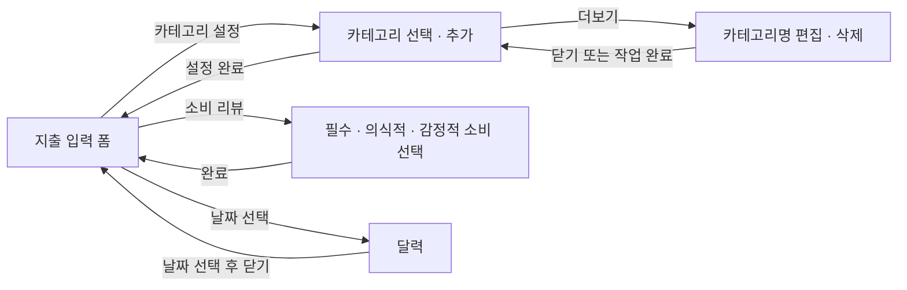

카테고리 설정·편집, 소비 리뷰, 달력, 회고 상세는 별도 URL로 이동하지 않는 오버레이 또는 드로어입니다.
지출 폼에서 카테고리를 선택한 뒤에도 지출 자체의 저장 버튼을 눌러야 기록이 저장됩니다.

## 화면과 소스

| 화면 | 경로 또는 진입점 | 소스 |
| --- | --- | --- |
| 로그인 | `/login` | [login.index.tsx](../src/pages/login.index.tsx) |
| 소셜 로그인 콜백 | `/login/$service` | [login.$service.index.tsx](../src/pages/login.$service.index.tsx) |
| 지출 목록 | `/expenses` | [expenses.index.tsx](../src/pages/expenses.index.tsx) |
| 지출 추가 | `/expenses/new` | [expenses.new.index.tsx](../src/pages/expenses.new.index.tsx) |
| 지출 수정·삭제 | `/expenses/$uid` | [expenses.$uid.index.tsx](../src/pages/expenses.$uid.index.tsx) |
| 카테고리 선택·추가 | 지출 폼 → 카테고리 설정 | [CategoriesPopoverPage.tsx](../src/features/category/ui/CategoriesPopoverPage.tsx) |
| 카테고리 편집·삭제 | 카테고리 설정 → 더보기 | [CategoryPopoverPage.tsx](../src/features/category/ui/CategoryPopoverPage.tsx) |
| 소비 리뷰 | 지출 폼 → 소비 리뷰 | [ConsumptionKindDrawer.tsx](../src/features/expense/ui/ConsumptionKindDrawer/ConsumptionKindDrawer.tsx) |
| 회고 | `/expenses/retrospective` | [RetrospectiveView.tsx](../src/features/retrospective/ui/RetrospectiveView.tsx) |
| 회고 상세 | 회고 카드 → 자세히보기 | [RetrospectiveDetailPopoverPage.tsx](../src/features/retrospective/ui/RetrospectiveDetailPopoverPage.tsx) |
| 설정 | `/settings` | [settings.index.tsx](../src/pages/settings.index.tsx) |
| 회원정보 | `/settings/account` | [settings.account.tsx](../src/pages/settings.account.tsx) |
| 개인정보 처리방침 | `/privacy` | [privacy.tsx](../src/pages/privacy.tsx) |

## 실행 화면 갤러리

이미지는 원본 파일을 직접 표시하며, 클릭하면 같은 원본을 열 수 있습니다.

### 1. 로그인

온보딩과 소셜 로그인 버튼을 제공합니다. 인증 완료 후 지출 목록으로 진입하며, 닉네임이 없으면 회원정보 설정을 먼저 진행합니다.

[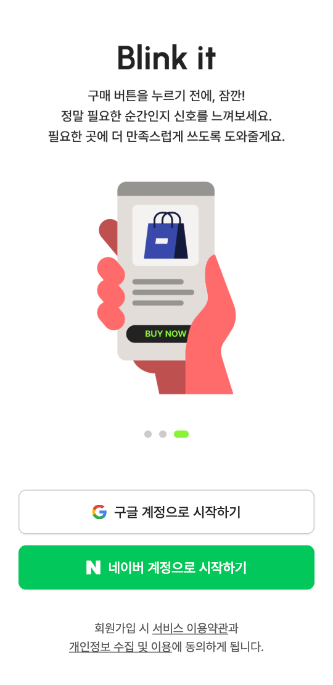](../screenshots/origins/login-page.png)

### 2. 지출 목록

월을 선택해 총 소비 금액과 날짜별 지출을 확인합니다. 추가 버튼으로 새 지출을 기록하고, 기존 카드를 선택하면 수정 화면으로 이동합니다.
지출이 없으면 추가 안내가 표시됩니다.

[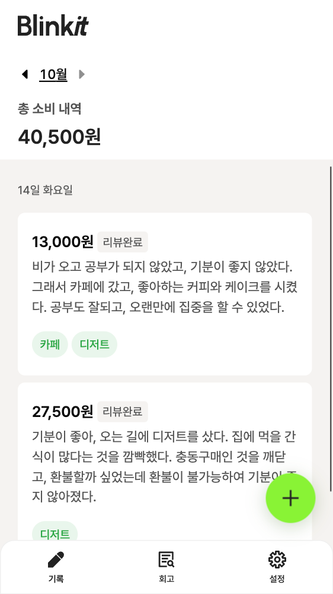](../screenshots/origins/expenses-page.png)

### 3. 지출 추가

날짜·메모·카테고리·금액을 입력하고 소비를 리뷰합니다. 메모는 1~120자, 카테고리는 1~3개, 금액은 양수여야 저장할 수 있습니다.
소비 리뷰는 선택 사항이며, 필수 소비·의식적 소비·감정적 소비 중 하나로 분류합니다.

[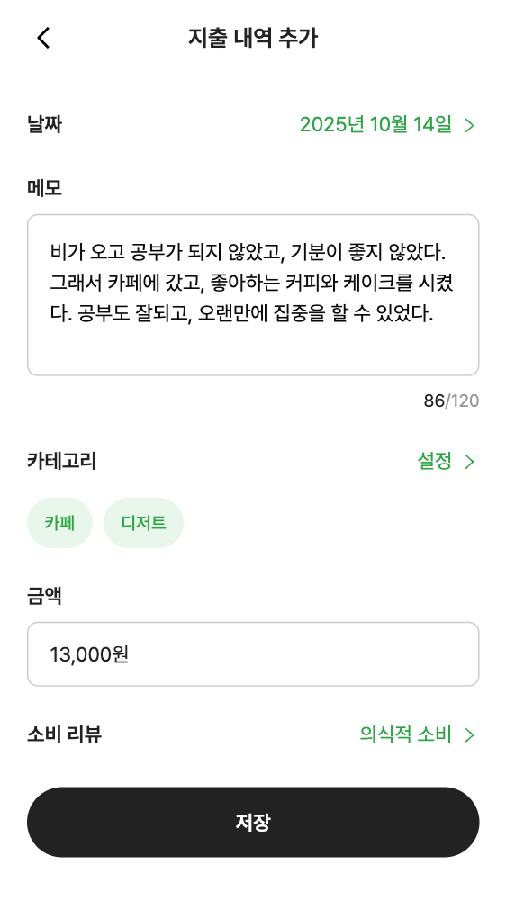](../screenshots/origins/add-expense-page.png)

### 4. 카테고리 선택·추가

기존 카테고리를 선택하거나 새 이름을 입력해 추가합니다. 최대 3개를 선택한 뒤 설정 완료를 누르면 지출 폼에 반영됩니다.

[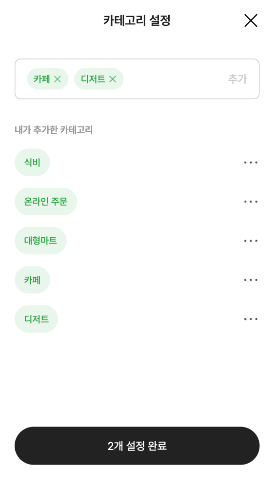](../screenshots/origins/add-select-category-page.png)

### 5. 카테고리 편집·삭제

카테고리의 더보기에서 이름 편집과 삭제 화면을 엽니다. 삭제 전 확인 드로어가 표시되며, 연결된 지출에서 해당 태그도 제거된다는 안내를 제공합니다.

[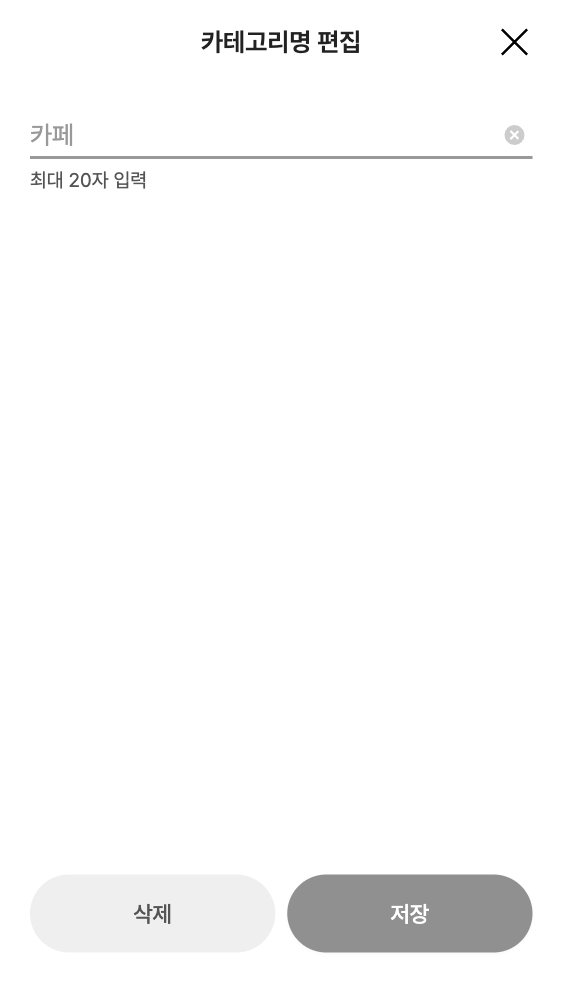](../screenshots/origins/category-detail-page.png)

### 6. 지출 수정·삭제

기존 지출의 입력값과 소비 분류를 변경하고 저장합니다. 삭제는 확인 드로어에서 확정하며, 저장·삭제 성공 시 지출 목록으로 돌아갑니다.

[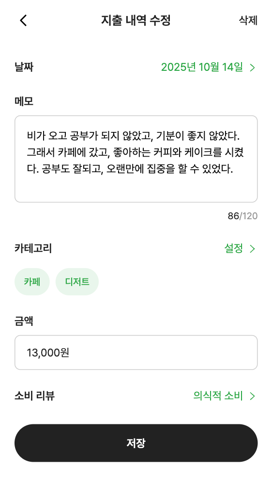](../screenshots/origins/edit-expense-page.png)

### 7. 회고

선택한 월의 소비를 감정적·의식적·필수 소비로 나눠 금액과 비중, 건수, 카테고리별 금액을 확인합니다.
아직 리뷰한 소비가 없으면 기록 화면으로 이동하는 안내를 표시합니다.

[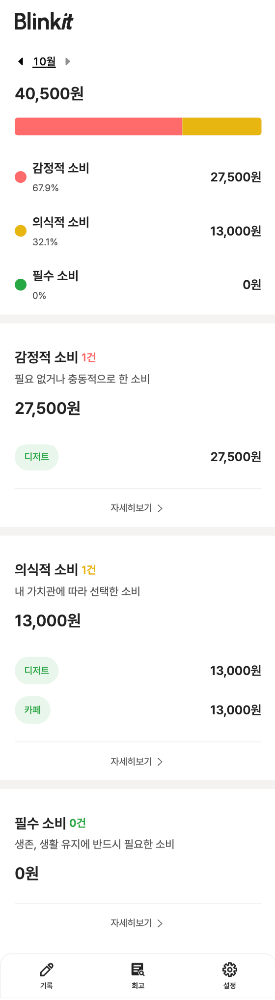](../screenshots/origins/retrospective-page.png)

### 8. 회고 상세

회고 카드의 자세히보기에서 해당 월·소비 분류의 지출을 확인하고 카테고리로 필터링합니다.
상단 금액은 해당 소비 분류 전체 합계이며, 목록의 건수와 내역은 선택한 카테고리에 따라 달라집니다.

[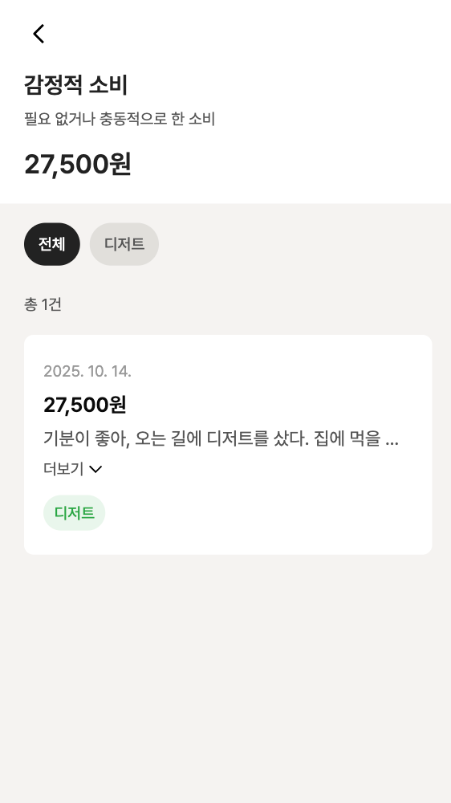](../screenshots/origins/retrospective-detail-page.png)

### 9. 설정

회원정보 수정, 서비스 이용약관, 개인정보 처리방침, 로그아웃으로 연결됩니다. 로그아웃은 확인 드로어에서 확정합니다.

[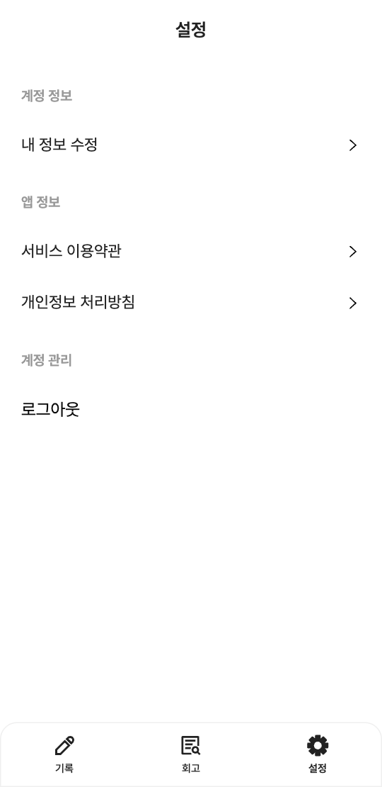](../screenshots/origins/settings.png)

### 10. 회원정보

이메일을 확인하고 닉네임을 변경합니다. 닉네임은 1~20자이며, 최초 설정 후에는 지출 목록으로, 기존 닉네임 변경 후에는 설정 화면으로 돌아갑니다.

[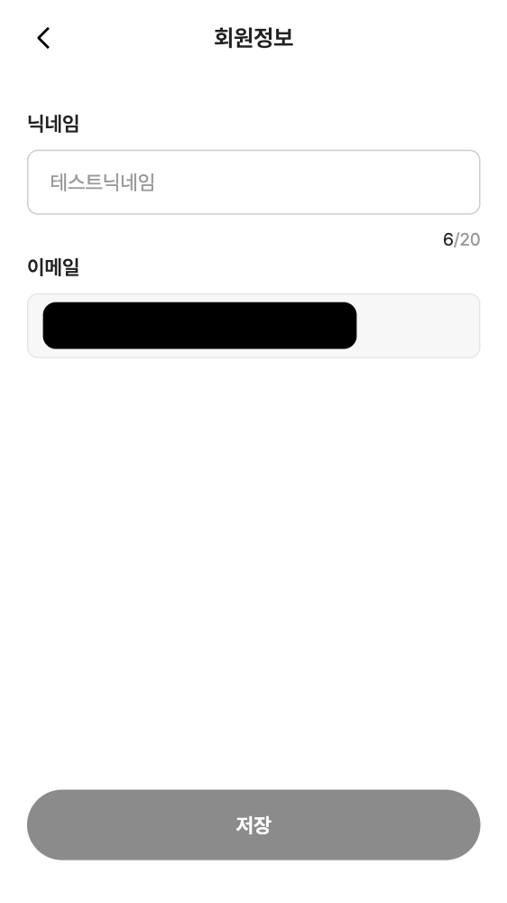](../screenshots/origins/edit-nickname-page.png)

## 모바일·데스크톱 시연 기록

현재 [공통 Layout](../src/shared/ui/layout/Layout.tsx)은 최소 360px, 최대 430px 너비의 화면을 중앙에 배치합니다.
데스크톱에서도 같은 화면 구조를 사용하므로, 두 환경의 기록은 화면 크기와 입력 방식의 차이를 보여주는 용도로 구분합니다.
위 기존 원본 이미지들은 모바일·데스크톱별 최신 촬영 결과를 의미하지 않습니다.

| 구분 | 촬영 기준 | 기록 상태 |
| --- | --- | --- |
| 모바일 | 예: 390 × 844 CSS px, 브라우저 모바일 에뮬레이션 사용 여부 명시 | 새 캡처·영상 미추가 |
| 데스크톱 | 예: 1440 × 900 CSS px, 중앙 앱 영역과 주변 여백 포함 | 새 캡처·영상 미추가 |

두 환경에서 같은 순서로 시연하면 비교하기 쉽습니다.

1. 로그인된 지출 목록에서 시작합니다. 소셜 로그인은 촬영 전에 완료합니다.
2. 지출 추가에서 메모·카테고리·금액을 입력하고 소비 리뷰를 선택한 뒤 저장합니다.
3. 목록에서 저장 결과와 합계를 확인하고, 해당 지출의 메모를 수정합니다.
4. 회고로 이동해 세 소비 분류의 금액과 비중을 확인합니다.
5. 자세히보기에서 카테고리 필터를 선택하고 목록 변화를 보여줍니다.

회고 비교용 가상 데이터 예시:

| 메모 | 금액 | 카테고리 | 소비 리뷰 |
| --- | ---: | --- | --- |
| 일주일 식단을 생각하며 장보기 | 45,800원 | 식비 | 필수 소비 |
| 읽고 싶었던 책 구입 | 18,000원 | 자기계발 | 의식적 소비 |
| 스트레스가 쌓여 주문한 디저트 | 16,500원 | 카페 | 감정적 소비 |

캡처를 갱신할 때는 데모 계정의 가상 데이터로 촬영하고, 촬영 날짜·프론트엔드 커밋·접속 환경·뷰포트·에뮬레이션 여부를 함께 기록합니다.
모바일과 데스크톱 파일은 각각 `screenshots/origins/mobile/`, `screenshots/origins/desktop/` 아래에 보관하고, 실제 파일을 추가한 뒤 이 문서에 연결합니다.
